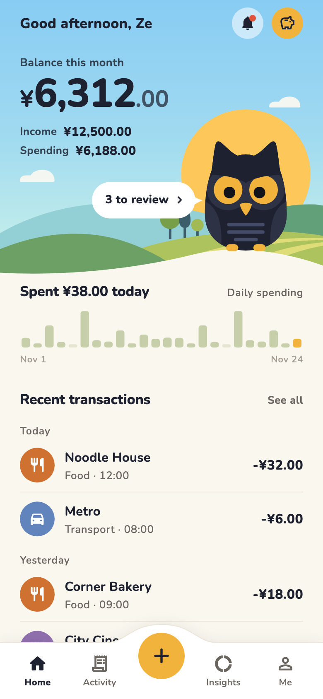
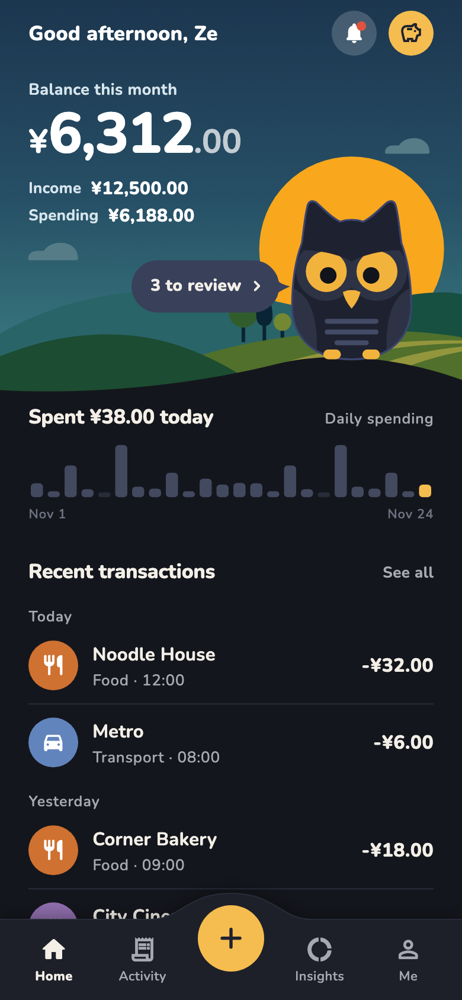

<p align="center">
  
</p>

<h1 align="center">Zowl</h1>

<p align="center">
  A self-hosted personal ledger for people who pay with Alipay and WeChat.<br>
  The Android app notices payments as they happen; nothing is posted until you confirm it.
</p>

<p align="center">
  <b>English</b> · <a href="README.zh-CN.md">简体中文</a>
</p>

<p align="center">
  
  &nbsp;
  
</p>

Zowl is a Next.js web app and server paired with a Flutter mobile client. On Android it can capture the
payment-success page of Alipay or WeChat while you pay and turn it into a ledger candidate, so most expenses
are recorded without typing. Statements, screenshots, and manual entries all go through the same review step,
with duplicate detection across sources.

> [!NOTE]
> Zowl is a personal project the author uses every day. Automatic capture depends on the screen layouts of
> third-party apps and has been tested mainly on one Xiaomi phone running HyperOS. Expect it to miss some
> payments on other phones and app versions. Statement import and manual entry do not depend on it.

## Features

**Getting transactions in**

- **Payment page capture (Android):** an accessibility service reads the payment-success page of Alipay and
  WeChat. Taobao, Pinduoduo, JD.com, Pupu, and Xianyu are experimental sources that are off by default. When an app shows no
  readable text (Android 14+), the window is read by on-device OCR instead.
- **Statement import:** Alipay and WeChat Pay CSV/XLSX exports, or any CSV/XLSX with field mapping. You preview
  every row before anything is posted.
- **Screenshots:** upload one or more payment screenshots, or share them to the app. Recognition uses a
  pluggable HTTP provider. The default `mock` provider never sends images anywhere and leaves fields for you to
  fill in.
- **Manual entry**.

**Keeping it accurate**

- Every source lands as a candidate first. You confirm it from a notification action or the review inbox.
  Auto-posting can be turned on separately for captured payments under an amount limit.
- Duplicate detection: exact duplicates, the same platform transaction ID across sources, and possible
  duplicates within ±5 minutes.
- Posted transactions keep immutable revisions. Edits create a new revision and voiding replaces deleting.
- Amounts are stored as integers in minor units. Different currencies are never added together.

**Organizing and reviewing**

- Categories, merchant rules learned from your corrections, search with combined filters.
- Optional AI categorization through any OpenAI-compatible API, including local models. It is off by default.
  It only sees merchant, description, type, source, and your category names.
- Monthly summaries, category and payment-source breakdowns, and trends in your own time zone.
- Several accounts on one server: one administrator, member accounts, and data isolated per user.
- Chinese and English UI on web and mobile, plus light and dark themes with four accent colors.

## Privacy

Zowl keeps your data on a server you run. It contains no analytics, telemetry, or crash reporting.

- **On the phone:** page text and screenshots are parsed in memory and never written to disk or uploaded. Only
  the structured candidate leaves the device: amount, time, source, and sometimes the merchant. Pending
  candidates wait in a queue encrypted with Android Keystore (AES-GCM), capped at 100 items or 7 days.
- **Order details (opt-in):** for Taobao and Pinduoduo you can turn on item recognition. The text of the
  surrounding order screens is scrubbed of phone numbers, addresses, and long digit runs, then sent once to your
  server, which passes it to your configured AI provider and does not store it.
- **Capture log:** a local diagnostic log records window names, counts, and rejection reasons. It contains no
  page text, amounts, or merchants. It never leaves the phone unless you export it yourself.
- **Server:** original statements and screenshots are stored with random filenames and `0600` permissions and
  are only served to their owner. Saved AI API keys are encrypted with AES-256-GCM.

The [architecture decision records](docs/adr/) describe each of these boundaries and why they were chosen.

## How it fits together

```
┌─────────────────────┐   HTTPS + bearer token   ┌──────────────────────────────┐
│ Flutter app         │ ───────────────────────► │ Next.js server (src/)        │
│  mobile/lib         │                          │  web UI + REST API           │
│ Android capture     │                          │  SQLite via Drizzle          │
│  mobile/android/…   │                          │  original files on disk      │
│  (Kotlin, ML Kit)   │                          │                              │
└─────────────────────┘                          └──────────────┬───────────────┘
                                                                │ optional
                                                   AI categorization / screenshot
                                                   recognition providers you configure
```

| Path | Contents |
| --- | --- |
| `src/` | Next.js 16 app: pages, API routes, and services (import, capture, ledger, categorization) |
| `drizzle/` | SQLite migrations |
| `mobile/` | Flutter client for Android and iOS ([mobile/README.md](mobile/README.md)) |
| `mobile/android/app/src/main/kotlin/com/zowl/mobile/capture/` | Accessibility service, page parsers, encrypted queue |
| `tests/e2e/` | Playwright tests for the web app and the mobile API contract |
| `docs/adr/` | Architecture decision records |
| `CONTEXT.md` | Domain glossary (posting, revisions, candidates, …) |

Stack: Next.js 16, React 19, TypeScript, Tailwind CSS, SQLite + Drizzle ORM, Zod, Recharts, PapaParse, SheetJS,
Flutter 3.38, Kotlin, Google ML Kit text recognition, Vitest, Playwright.

## Quick start (development)

Requires Node.js 22.5 or later.

```bash
git clone https://github.com/lalaze/Zowl.git
cd Zowl
npm install
cp .env.example .env
npm run db:setup     # migrations + demo data
npm run dev
```

Open <http://localhost:3000> and sign in with the demo account `demo@zemoney.local` / `zemoney-demo`.
To try importing, use the sample statements in `src/services/import-service/fixtures/`.

`npm install` downloads SheetJS from `cdn.sheetjs.com`, because SheetJS no longer publishes to npm.

### Mobile app

Requires Flutter 3.38. Start the server on all interfaces, then run the app on an Android emulator:

```bash
npm run dev -- --hostname 0.0.0.0

cd mobile
flutter pub get
dart run build_runner build
flutter run \
  --dart-define=API_BASE_URL=http://10.0.2.2:3000 \
  --dart-define=ALLOW_INSECURE_LOCAL_API=true
```

On the iOS simulator use `http://127.0.0.1:3000`. On a physical phone, debug builds also accept plain HTTP to a
Tailscale IP (`100.64.0.0/10`), e.g. `--dart-define=API_BASE_URL=http://100.x.y.z:3000`. Any other host, and every
release build, needs HTTPS. See [mobile/README.md](mobile/README.md) for tests, capture setup, and platform notes.

## Self-hosting

The server runs as a single Docker container with SQLite. It must sit behind HTTPS (a reverse proxy, Tailscale
Serve, or similar), because the production build refuses to start without an `https://` `PUBLIC_BASE_URL`.

```bash
cp .env.docker.example .env.docker
# Edit .env.docker: PUBLIC_BASE_URL=https://money.example.com and ZEMONEY_HOST=money.example.com

mkdir -p runtime/data runtime/storage runtime/releases/android secrets
openssl rand -hex 32 > secrets/initial-admin-setup-token
chmod 700 runtime/data runtime/storage secrets
chmod 600 secrets/initial-admin-setup-token
sudo chown -R 1000:1000 runtime secrets          # the container runs as uid 1000

docker network create traefik-proxy              # skip if this network already exists
docker compose --env-file .env.docker up -d --build app
```

The container listens on `127.0.0.1:3000` on the host and carries Traefik labels for the external
`traefik-proxy` network. Point your reverse proxy at either one. Then:

1. Visit `PUBLIC_BASE_URL`. An empty database redirects to `/setup`.
2. Paste the token from `secrets/initial-admin-setup-token` and create the administrator account.
3. Delete the token file. Setup closes for good once any account exists.

Migrations run automatically when the container starts. Back up `runtime/data` and `runtime/storage` together,
with the container stopped. Upgrades, backup, restore, and the Android download page are covered in
[docs/docker-deployment.md](docs/docker-deployment.md).

### Android app for your server

Zowl is not published to any app store. Build a release APK that points at your server and signs with your
own keystore:

```bash
API_BASE_URL=https://money.example.com \
ANDROID_KEYSTORE_PATH=/path/to/release.jks \
ANDROID_KEYSTORE_PASSWORD_FILE=/path/to/keystore-password \
ANDROID_KEY_ALIAS=release \
ANDROID_KEY_PASSWORD_FILE=/path/to/key-password \
npm run mobile:release
```

The APK and `release.json` are written to `releases/android/`. Copy both into `runtime/releases/android/` and
the server offers the download at `/android`. To enable capture after installing, open
**Me → Automatic payment capture**, turn on the master switch, and allow the Zowl accessibility service in
Android settings.

The iOS app builds from the same project and supports everything except automatic capture, which is
Android-only. You need your own Apple signing to install it.

## Configuration

Server settings come from environment variables. `.env.example` (development) and `.env.docker.example`
(Docker) list them with comments.

| Variable | Default | Description |
| --- | --- | --- |
| `DATABASE_URL` | `.data/zemoney.sqlite` | SQLite file. Use a persistent volume in production |
| `FILE_STORAGE_ROOT` | `storage` | Uploaded statements and screenshots |
| `PUBLIC_BASE_URL` | — | External HTTPS URL. Required in production; used for same-origin checks |
| `INITIAL_ADMIN_SETUP_TOKEN_FILE` | — | One-time secret file (≥ 32 characters) for creating the first administrator |
| `ANDROID_RELEASE_ROOT` | — | Read-only directory with the APK and `release.json` for the download page |
| `SESSION_TTL_DAYS` | `30` | Login session lifetime |
| `DEMO_EMAIL` / `DEMO_PASSWORD` | `demo@zemoney.local` / `zemoney-demo` | Demo account for `db:seed`. Development only |
| `RECEIPT_RECOGNITION_PROVIDER` | `mock` | `mock` or `http` |
| `RECEIPT_RECOGNITION_HTTP_ENDPOINT` | — | HTTPS endpoint for screenshot recognition |
| `RECEIPT_RECOGNITION_HTTP_API_KEY` | — | Bearer key for that endpoint |
| `RECEIPT_RECOGNITION_HTTP_TIMEOUT_MS` | `30000` | Per-image timeout (100–120000 ms) |
| `AI_CATEGORIZATION_PROVIDER` | `off` | `off` or `openai-compatible` |
| `AI_CATEGORIZATION_BASE_URL` | — | For example `https://api.openai.com/v1` or a local server |
| `AI_CATEGORIZATION_MODEL` | — | Model name. There is no vendor default |
| `AI_CATEGORIZATION_API_KEY` | — | Required for public services, optional for local or private addresses |
| `AI_CATEGORIZATION_RESPONSE_MODE` | `json_schema` | `json_schema`, or `json_object` for less capable local models |
| `AI_CATEGORIZATION_AUTO_THRESHOLD` | `0.85` | Confidence needed to apply a category without asking |
| `AI_CATEGORIZATION_BATCH_SIZE` | `20` | Groups per request (1–50) |
| `AI_CATEGORIZATION_TIMEOUT_MS` | `30000` | Per-batch timeout (100–120000 ms) |
| `AI_CATEGORIZATION_ALLOW_INSECURE_HTTP` | `false` | Must be `true` to use any plain-HTTP provider |
| `AI_CATEGORIZATION_ENCRYPTION_KEY` | — | Base64 32-byte key (`openssl rand -base64 32`) that encrypts API keys saved in the web settings. Back it up |

Users can also save their own AI provider in the web settings. A saved provider overrides the environment
defaults for that user.

<details>
<summary>Screenshot recognition provider contract</summary>

In `http` mode the upload page tells the user that images will be sent, and the server checks that consent
again. The server POSTs to your endpoint:

```json
{
  "instructions": "Extract only transaction facts explicitly visible in the image...",
  "image": { "base64": "...", "mimeType": "image/png" },
  "responseFormat": {
    "type": "json_schema",
    "name": "receipt_recognition",
    "strict": true,
    "schema": {}
  }
}
```

The endpoint must return a JSON object that matches the supplied schema. Extra fields, free text, timestamps
without a time zone, and missing keys are rejected. Redirects, non-JSON or oversized responses, and timeouts
become failed items that the user completes by hand.

</details>

## Development

| Command | Purpose |
| --- | --- |
| `npm run dev` | Development server |
| `npm run lint` / `npm run typecheck` | ESLint and TypeScript checks |
| `npm test` | Vitest unit and service tests |
| `npm run test:e2e` | Playwright web tests (run `npx playwright install chromium` first) |
| `npm run db:generate` | Generate a migration after changing the schema |
| `npm run db:migrate` | Apply migrations |
| `npm run test:mobile:quick` | Flutter analyze, tests, and coverage gate |
| `npm run test:mobile:contract` | Mobile API contract against the real server |
| `npm run test:mobile:e2e:android` / `:ios` | Device tests on an emulator or simulator |

Playwright uses its own database (`.data/zemoney-e2e.sqlite`) and storage directory, so it never touches your
development data.

Before changing ledger behavior, read [CONTEXT.md](CONTEXT.md) and the related [ADRs](docs/adr/). They define
the terms the code uses and the decisions that are deliberately strict, such as never deleting a posted
transaction. Bugs and ideas go to [GitHub Issues](https://github.com/lalaze/Zowl/issues). See
[CONTRIBUTING.md](CONTRIBUTING.md) before opening a pull request, and [SECURITY.md](SECURITY.md) to report a
vulnerability.

### About the name

The project started as **zeMoney** and the app is now **Zowl**. Internal identifiers still use the old name:
the npm package, `ZEMONEY_*` Docker variables, the `zemoney.sqlite` database file, the Docker image, and the
demo account. Renaming them would break existing deployments, so they stay for now.

## Disclaimer

Zowl is not affiliated with or endorsed by Alipay, Ant Group, WeChat, Tencent, Taobao, Pinduoduo, JD.com, Pupu, Xianyu, or any
bank. Their names are used only to describe compatibility. Capture reads your own screen on your own device and
can break whenever those apps change. Check important figures against official statements. The software is
provided as is, without warranty. See the license.

## License

[MIT](LICENSE). The bundled Nunito font is licensed under the SIL Open Font License 1.1
(`mobile/assets/fonts/Nunito-OFL.txt`). The app's sky and hills are drawn in code after
AI-generated originals; see `mobile/tool/brand/scene_prompts.md`.
