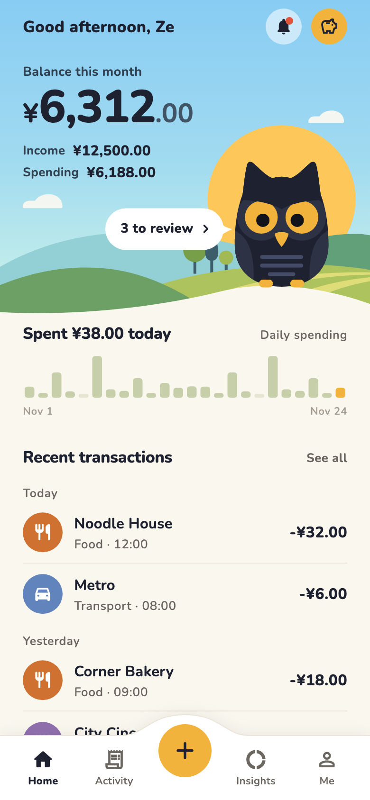
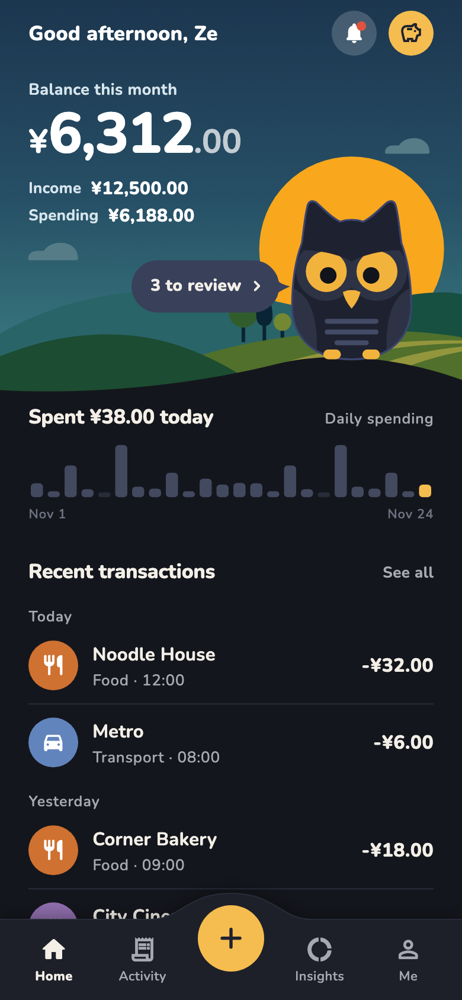

<p align="center">
  
</p>

<h1 align="center">Zowl</h1>

<p align="center">
  给用支付宝、微信付钱的人用的自托管记账本。<br>
  Android 端在你付款时自动记下这笔支出，经你确认后才会入账。
</p>

<p align="center">
  <a href="README.md">English</a> · <b>简体中文</b>
</p>

<p align="center">
  
  &nbsp;
  
</p>

Zowl 由一个 Next.js 网页端（同时是服务端）和一个 Flutter 移动端组成。在 Android 上，它能在你付款时读取支付宝或微信的
支付成功页，生成一条待确认的记账，大部分支出不用手动输入。账单导入、截图识别和手动记账都走同一个审核流程，并在不同来源之间
查重。

> [!NOTE]
> 这是作者自己每天在用的个人项目。自动采集依赖第三方 App 的页面结构，主要在一台运行 HyperOS 的小米手机上测试过。
> 换一台手机或换个 App 版本，可能会漏记。账单导入和手动记账不受影响。

## 功能

**记进来**

- **付款页采集（Android）**：通过无障碍服务读取支付宝、微信的支付成功页。淘宝、拼多多、京东、朴朴、闲鱼是实验性来源，默认关闭。
  页面读不到文字时（Android 14+），改用本机 OCR 识别这个窗口。
- **账单导入**：支付宝、微信支付导出的 CSV/XLSX，或任意 CSV/XLSX（可映射字段）。入账前逐行预览。
- **截图识别**：上传一张或多张付款截图，也可以从别的 App 分享进来。识别服务可替换。默认的 `mock` 不会把图片发到任何
  地方，字段留给你手动填。
- **手动记账**，以及一个快捷设置磁贴：在付款页上点一下，用本机 OCR 生成预填好的草稿。

**记得准**

- 所有来源都先变成候选，你在通知栏操作或审核列表里确认。付款页采集可以单独开启自动入账，并设金额上限。
- 查重：完全重复、跨来源的同一平台交易号，以及 ±5 分钟内的疑似重复。
- 已入账的交易保留不可变的修订记录。修改会产生新修订，作废代替删除。
- 金额以最小货币单位的整数存储，不同币种从不相加。

**整理和回顾**

- 分类、根据你的修改学习出的商户规则、组合筛选搜索。
- 可选的 AI 分类，支持任何 OpenAI 兼容接口（包括本地模型），默认关闭。AI 只看到商户、描述、收支类型、来源和你的
  分类名称。
- 月度汇总、按分类和支付方式的占比、按你所在时区计算的趋势。
- 一台服务器可以有多个账号：一个管理员、若干成员，数据按用户隔离。
- 网页和移动端都支持中英文界面，有浅色/深色主题和四种强调色。

## 隐私

数据存在你自己运行的服务器上。项目里没有统计、遥测或崩溃上报。

- **手机上**：页面文字和截图只在内存里解析，不写入磁盘，也不上传。离开手机的只有结构化的候选：金额、时间、来源，有时还有
  商户。待上传的候选存放在 Android Keystore（AES-GCM）加密的队列里，最多 100 条或 7 天。
- **订单明细（需手动开启）**：淘宝和拼多多可以打开商品识别。下单前后几屏的文字会先去掉手机号、地址和长数字串，
  再发给你的服务器一次。服务器把它转给你配置的 AI 服务，自己不保存。
- **采集日志**：本机诊断日志只记录窗口名、计数和拒绝原因，不含页面文字、金额或商户。除非你自己导出，它不会离开手机。
- **服务器**：原始账单和截图以随机文件名、`0600` 权限保存，只对上传者本人开放。保存的 AI API Key 用 AES-256-GCM 加密。

每条边界的来由和取舍记录在[架构决策记录](docs/adr/)里。

## 整体结构

```
┌─────────────────────┐   HTTPS + Bearer token   ┌──────────────────────────────┐
│ Flutter App         │ ───────────────────────► │ Next.js 服务 (src/)           │
│  mobile/lib         │                          │  网页界面 + REST API          │
│ Android 采集        │                          │  SQLite（Drizzle）           │
│  mobile/android/…   │                          │  原始文件存本地磁盘           │
│  (Kotlin, ML Kit)   │                          │                              │
└─────────────────────┘                          └──────────────┬───────────────┘
                                                                │ 可选
                                                    你自己配置的 AI 分类 /
                                                    截图识别服务
```

| 路径 | 内容 |
| --- | --- |
| `src/` | Next.js 16 应用：页面、API 路由和各业务服务（导入、采集、账本、分类） |
| `drizzle/` | SQLite 迁移 |
| `mobile/` | Android/iOS 的 Flutter 客户端（[mobile/README.md](mobile/README.md)） |
| `mobile/android/app/src/main/kotlin/com/zowl/mobile/capture/` | 无障碍服务、页面解析器、加密队列 |
| `tests/e2e/` | 网页端和移动端 API 契约的 Playwright 测试 |
| `docs/adr/` | 架构决策记录 |
| `CONTEXT.md` | 领域术语表（入账、修订、候选……） |

技术栈：Next.js 16、React 19、TypeScript、Tailwind CSS、SQLite + Drizzle ORM、Zod、Recharts、PapaParse、SheetJS、
Flutter 3.38、Kotlin、Google ML Kit 文字识别、Vitest、Playwright。

## 本地开发

需要 Node.js 22.5 或更高版本。

```bash
git clone https://github.com/lalaze/Zowl.git
cd Zowl
npm install
cp .env.example .env
npm run db:setup     # 迁移 + 演示数据
npm run dev
```

打开 <http://localhost:3000>，用演示账号 `demo@zemoney.local` / `zemoney-demo` 登录。
想试导入，可以用 `src/services/import-service/fixtures/` 里的示例账单。

SheetJS 已不再发布到 npm，所以 `npm install` 会从 `cdn.sheetjs.com` 下载它。

### 移动端

需要 Flutter 3.38。让服务监听所有网卡，然后在 Android 模拟器上运行：

```bash
npm run dev -- --hostname 0.0.0.0

cd mobile
flutter pub get
dart run build_runner build
flutter run \
  --dart-define=API_BASE_URL=http://10.0.2.2:3000 \
  --dart-define=ALLOW_INSECURE_LOCAL_API=true
```

iOS 模拟器用 `http://127.0.0.1:3000`。在真机上，debug 包还允许用明文 HTTP 连 Tailscale IP（`100.64.0.0/10`），
例如 `--dart-define=API_BASE_URL=http://100.x.y.z:3000`。其他地址以及所有 release 包都必须用 HTTPS。测试、采集设置和
平台说明见 [mobile/README.md](mobile/README.md)。

## 自托管

服务端是一个使用 SQLite 的 Docker 容器，前面必须有 HTTPS（反向代理、Tailscale Serve 等都可以）：
生产模式下 `PUBLIC_BASE_URL` 不是 `https://` 就不会启动。

```bash
cp .env.docker.example .env.docker
# 编辑 .env.docker：PUBLIC_BASE_URL=https://money.example.com，ZEMONEY_HOST=money.example.com

mkdir -p runtime/data runtime/storage runtime/releases/android secrets
openssl rand -hex 32 > secrets/initial-admin-setup-token
chmod 700 runtime/data runtime/storage secrets
chmod 600 secrets/initial-admin-setup-token
sudo chown -R 1000:1000 runtime secrets          # 容器以 uid 1000 运行

docker network create traefik-proxy              # 如果这个网络已存在就跳过
docker compose --env-file .env.docker up -d --build app
```

容器在宿主机的 `127.0.0.1:3000` 上监听，同时带有接入外部 `traefik-proxy` 网络的 Traefik 标签，反向代理指向
其中任何一个都行。然后：

1. 访问 `PUBLIC_BASE_URL`，空数据库会跳转到 `/setup`。
2. 粘贴 `secrets/initial-admin-setup-token` 里的口令，创建管理员账号。
3. 删除这个口令文件。只要有任何账号存在，初始化入口就永久关闭。

容器启动时会自动执行迁移。备份时先停容器，把 `runtime/data` 和 `runtime/storage` 一起备份。升级、备份恢复、
Android 下载页的说明见 [docs/docker-deployment.md](docs/docker-deployment.md)。

### 为你的服务器打包 Android App

Zowl 没有上架任何应用商店。用你自己的 keystore 打一个指向你服务器的 release APK：

```bash
API_BASE_URL=https://money.example.com \
ANDROID_KEYSTORE_PATH=/path/to/release.jks \
ANDROID_KEYSTORE_PASSWORD_FILE=/path/to/keystore-password \
ANDROID_KEY_ALIAS=release \
ANDROID_KEY_PASSWORD_FILE=/path/to/key-password \
npm run mobile:release
```

APK 和 `release.json` 会输出到 `releases/android/`。把两个文件复制到 `runtime/releases/android/`，服务器就会在
`/android` 提供下载。安装后打开 **我的 → 支付自动采集**，打开总开关，再到 Android 设置里允许 Zowl 的无障碍服务。

iOS 版用同一个工程构建，除了自动采集和 OCR 磁贴（仅 Android）以外功能相同，需要你自己的 Apple 签名才能安装。

## 配置

服务端通过环境变量配置。`.env.example`（开发）和 `.env.docker.example`（Docker）里都有带注释的列表。

| 变量 | 默认值 | 说明 |
| --- | --- | --- |
| `DATABASE_URL` | `.data/zemoney.sqlite` | SQLite 文件。生产环境请放在持久卷上 |
| `FILE_STORAGE_ROOT` | `storage` | 上传的账单和截图 |
| `PUBLIC_BASE_URL` | — | 对外的 HTTPS 地址。生产环境必填，用于同源校验 |
| `INITIAL_ADMIN_SETUP_TOKEN_FILE` | — | 创建首个管理员用的一次性口令文件（至少 32 个字符） |
| `ANDROID_RELEASE_ROOT` | — | 只读目录，放 APK 和 `release.json`，供下载页使用 |
| `SESSION_TTL_DAYS` | `30` | 登录会话有效天数 |
| `DEMO_EMAIL` / `DEMO_PASSWORD` | `demo@zemoney.local` / `zemoney-demo` | `db:seed` 的演示账号，仅限开发 |
| `RECEIPT_RECOGNITION_PROVIDER` | `mock` | `mock` 或 `http` |
| `RECEIPT_RECOGNITION_HTTP_ENDPOINT` | — | 截图识别服务的 HTTPS 地址 |
| `RECEIPT_RECOGNITION_HTTP_API_KEY` | — | 该服务的 Bearer Key |
| `RECEIPT_RECOGNITION_HTTP_TIMEOUT_MS` | `30000` | 单张图片超时（100–120000 毫秒） |
| `AI_CATEGORIZATION_PROVIDER` | `off` | `off` 或 `openai-compatible` |
| `AI_CATEGORIZATION_BASE_URL` | — | 例如 `https://api.openai.com/v1` 或本地服务 |
| `AI_CATEGORIZATION_MODEL` | — | 模型名，没有默认厂商 |
| `AI_CATEGORIZATION_API_KEY` | — | 公网服务必填，本地或内网地址可不填 |
| `AI_CATEGORIZATION_RESPONSE_MODE` | `json_schema` | `json_schema`；能力较弱的本地模型用 `json_object` |
| `AI_CATEGORIZATION_AUTO_THRESHOLD` | `0.85` | 不经询问直接采用分类所需的置信度 |
| `AI_CATEGORIZATION_BATCH_SIZE` | `20` | 每次请求的分组数（1–50） |
| `AI_CATEGORIZATION_TIMEOUT_MS` | `30000` | 每批超时（100–120000 毫秒） |
| `AI_CATEGORIZATION_ALLOW_INSECURE_HTTP` | `false` | 使用任何明文 HTTP 服务都必须设为 `true` |
| `AI_CATEGORIZATION_ENCRYPTION_KEY` | — | Base64 编码的 32 字节密钥（`openssl rand -base64 32`），用来加密网页设置里保存的 API Key。请备份 |

每个用户也可以在网页设置里保存自己的 AI 服务，它会覆盖该用户的环境变量默认值。

截图识别服务（`http` 模式）的请求和响应格式见 [英文 README](README.md#configuration)。

## 开发

| 命令 | 用途 |
| --- | --- |
| `npm run dev` | 开发服务器 |
| `npm run lint` / `npm run typecheck` | ESLint 和 TypeScript 检查 |
| `npm test` | Vitest 单元和服务测试 |
| `npm run test:e2e` | Playwright 网页测试（先运行 `npx playwright install chromium`） |
| `npm run db:generate` | 修改 schema 后生成迁移 |
| `npm run db:migrate` | 执行迁移 |
| `npm run test:mobile:quick` | Flutter 静态分析、测试和覆盖率门槛 |
| `npm run test:mobile:contract` | 用真实服务端跑移动端 API 契约测试 |
| `npm run test:mobile:e2e:android` / `:ios` | 在模拟器上跑设备测试 |

Playwright 使用独立的数据库（`.data/zemoney-e2e.sqlite`）和存储目录，不会动你的开发数据。

修改账本相关逻辑之前，请先读 [CONTEXT.md](CONTEXT.md) 和相关的 [ADR](docs/adr/)。它们定义了代码里用到的术语，
也解释了那些刻意从严的决定，比如已入账的交易永不删除。问题和建议请提到 [GitHub Issues](https://github.com/lalaze/Zowl/issues)。
提 PR 前请看 [CONTRIBUTING.md](CONTRIBUTING.md)，报告安全漏洞请看 [SECURITY.md](SECURITY.md)。

### 关于名字

项目最早叫 **zeMoney**，App 现在叫 **Zowl**。内部标识仍沿用旧名：npm 包名、Docker 用的 `ZEMONEY_*` 变量、
`zemoney.sqlite` 数据库文件、Docker 镜像和演示账号。改名会破坏已有部署，所以暂时保留。

## 免责声明

Zowl 与支付宝、蚂蚁集团、微信、腾讯、淘宝、拼多多、京东、朴朴、闲鱼及任何银行均无关联，也未获得其认可。文中提到这些名称只是为了
说明兼容性。采集只是在你自己的设备上读取你自己的屏幕，这些 App 一改版就可能失效。重要的数字请以官方账单为准。
本软件按“原样”提供，不附带任何担保，详见许可证。

## 许可证

[MIT](LICENSE)。内置的 Nunito 字体采用 SIL Open Font License 1.1（`mobile/assets/fonts/Nunito-OFL.txt`）。
首页背景图由 AI 生成，见 `mobile/tool/brand/scene_prompts.md`。
