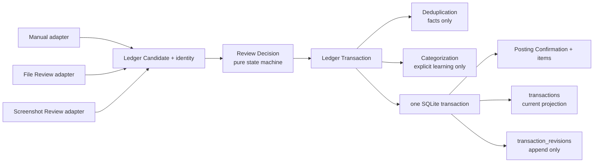
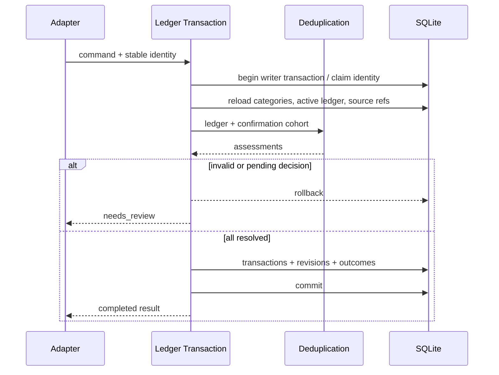

# Ledger Transaction Architecture

- Status: Implemented; migrations generated but not applied to a real database
- Discovered: 2026-07-15
- Decisions closed: 2026-07-16
- Scope: manual entry, file import, screenshot recognition, transaction amendment, and transaction voiding

## Implementation update

The Ledger Transaction module is now the only production writer for formal Transactions. Manual,
file-import, and screenshot-recognition adapters all submit typed candidates and stable confirmation
identities; amendments and voiding append immutable revisions with optimistic concurrency and
idempotency. File and screenshot confirmations reload their persisted source records inside the
Ledger transaction, and a new migration gives existing rows an honest `legacy_snapshot` without
fabricating confirmation or actor history.

Normal lists, filters, category usage, statistics, and deduplication exclude voided Transactions;
file-reference auditing deliberately continues to include them. The old transaction-service
create/update/remove SQL and both import-path Transaction inserts have been deleted. The generated
migrations have only been exercised against temporary databases in tests; no real database was
migrated during implementation.

## Conclusion

Create a deep `Ledger Transaction` module as the sole posted-transaction writer. Manual, file, and screenshot workflows only adapt results into canonical `Ledger Candidate` objects; they no longer enforce final ledger constraints, recheck duplicates, write `transactions`, or interpret final outcomes themselves.

The module exposes only three write commands:

1. `confirmPosting`: confirm one or more candidates for posting.
2. `amendTransaction`: correct one active posted transaction.
3. `voidTransaction`: terminate a transaction and remove it from the active ledger.

It encapsulates idempotency, final duplicate review, batch atomicity, current projections, immutable revisions, voiding, provenance, and optional learning. Lists, search, statistics, parsing, OCR, category suggestions, and review UI are outside this interface.

## Why change now

The three posting paths currently implement similar but diverging ledger rules:

- Manual creation validates category/amount and fingerprints, but writes `unique` without querying duplicates: [transaction-service/index.ts](../../src/services/transaction-service/index.ts#L285).
- Manual amendments recalculate amount/time/fingerprint without duplicate checks, revisions, or a concurrency baseline; learning is a separate later write: [transaction-service/index.ts](../../src/services/transaction-service/index.ts#L332).
- Ordinary deletion physically removes transactions without explaining their disappearance: [transaction-service/index.ts](../../src/services/transaction-service/index.ts#L424).
- File confirmation validates and writes each item in its own transaction; per-item failures become `WRITE_FAILED` and processing continues, marking a partially posted batch complete: [import-service/index.ts](../../src/services/import-service/index.ts#L732).
- New `possible_duplicate` results during file confirmation are silently skipped instead of returning the entire confirmation to review: [import-service/index.ts](../../src/services/import-service/index.ts#L832).
- Screenshot confirmation has separate duplicate review, cohort comparison, decisions, and writes: [screenshot-recognition-service/index.ts](../../src/services/screenshot-recognition-service/index.ts#L990), [screenshot-recognition-service/index.ts](../../src/services/screenshot-recognition-service/index.ts#L1282).
- `Deduplication` queries only persisted `transactions`, without confirmation cohorts or amendment self-exclusion: [deduplication-service/index.ts](../../src/services/deduplication-service/index.ts#L20).
- `transactions` mixes current facts, review state, and raw provenance without confirmation audit or revision relations: [schema.ts](../../src/db/schema.ts#L203).
- File/screenshot review items each retain decisions, duplicates, and result transactions. These suit review lifecycles but should not define final posting truth: [schema.ts](../../src/db/schema.ts#L284), [schema.ts](../../src/db/schema.ts#L363).

The issue is fragmented ownership of ledger rules, not function length. Extracting helpers or moving SQL alone cannot stop the three paths diverging.

## Confirmed domain invariants

1. `Duplicate` never creates a second posted transaction and cannot be overridden.
2. `Possible Duplicate` posts only after an explicit override of the current assessment.
3. `Posting Confirmation` is atomic: invalid, pending, or newly possible-duplicate items cause zero posted writes.
4. Exact duplicates and explicitly skipped candidates do not enter the write set but receive final outcomes.
5. Fully resolved confirmations succeed and are audited even with zero new transactions.
6. Successful confirmations have stable identities: identical identity/digest retries return the original result; differing digests are rejected.
7. Amendments cannot change provenance; duplicates from new sources do not merge provenance into existing transactions.
8. Amendments preserve identity, require the current revision, and revalidate/deduplicate excluding self.
9. Voiding is terminal: exclude from lists, statistics, and duplicates while retaining identity, provenance, and revisions.
10. Initial posting, amendments, and voiding append immutable revisions.
11. Suggestions are outside final writing; Ledger validates category legality, and explicit learning commits with amendments.
12. Raw CSV rows, OCR responses, and third-party payloads never enter candidates or revisions.
13. Old transactions receive only `legacy_snapshot`; no fabricated confirmations, actors, or overrides.

Canonical definitions are in root [CONTEXT.md](../../CONTEXT.md).

## Target relationships



### Ledger Transaction owns

- Three public write commands and their input/output schemas.
- Final canonical fact validation.
- Category ownership and type compatibility.
- Provenance variant validity and immutability.
- Reloading persistent review candidates through concrete source loaders inside the final transaction.
- Server-side candidate/decision digests.
- Orchestration of final duplicate and cohort assessments.
- Final execution of Review Decision.
- Identity claims, idempotency, and item outcomes.
- The outer SQLite transaction and commit/rollback.
- Current `transactions` projections.
- Append-only `transaction_revisions` history.
- Voiding state.
- Explicitly authorized category learning during amendment.

### Ledger Transaction does not own

- Alipay, WeChat, or generic parsing.
- Recognition providers, OCR calls, or raw responses.
- File/screenshot editing, pagination, or task lifecycle.
- Category suggestion algorithms.
- Duplicate algorithm rules; `Deduplication` returns facts only.
- Transaction lists, details, search, statistics, or charts.
- Original-file lifecycle.
- Generic Repository, Unit of Work, or hypothetical PostgreSQL adapters.

## Canonical input

These types illustrate interface shape; exact implementation names are not required:

```ts
type LedgerFacts = {
  type: "expense" | "income" | "transfer" | "refund";
  amountMinor: number;
  currency: string;
  merchantName: string | null;
  description: string | null;
  categoryId: string | null;
  transactionTime: string;
  paymentMethod: string | null;
};

type SourceProvenance =
  | { kind: "manual" }
  | {
      kind: "file_import";
      importItemId: string;
      batchId: string;
      fileId: string;
      platform: "alipay" | "wechat" | "other";
      platformTransactionId: string | null;
    }
  | {
      kind: "screenshot_recognition";
      recognitionItemId: string;
      jobId: string;
      fileId: string;
      providerId: string;
      platformTransactionId: string | null;
      confidenceBasisPoints: number | null;
    };

type LedgerCandidate = {
  sourceItemRef: string;
  facts: LedgerFacts;
  provenance: SourceProvenance;
};
```

`SourceProvenance` is a finite typed immutable reference. `import_items` retains raw rows and recognition workflows retain payloads; Ledger does not accept a `Record<string, unknown>` escape hatch.

File/screenshot commands carry source item references, review versions, and adapter candidates. Inside the final transaction, concrete loaders rebuild canonical candidates from `import_items` or `recognition_items` and compare server digests. Callers cannot supply a transaction or treat outside snapshots as final truth. Manual candidates have no persistent review row and are reparsed against canonical schemas inside the transaction. No generic provider registry is introduced for these loaders.

## Public write interface

```ts
type LedgerTransactionCommands = {
  confirmPosting(
    context: CommandContext,
    command: PostingConfirmationCommand,
  ): ConfirmationOutcome;

  amendTransaction(
    context: CommandContext,
    command: TransactionAmendmentCommand,
  ): TransactionRevisionOutcome;

  voidTransaction(
    context: CommandContext,
    command: TransactionVoidCommand,
  ): TransactionRevisionOutcome;
};
```

### confirmPosting

Input includes:

- Adapter-generated, stably persisted confirmation ID and version.
- Ordered candidates.
- Current review decision for each item.
- Optional `Possible Duplicate Override` with deduplication identity, match, reason, and algorithm version.

Only two outputs exist:

- `completed`: immutable outcomes, each `posted`, `duplicate`, or `skipped`.
- `needs_review`: new validation/duplicate facts, with no successful confirmation or transaction writes.

Unexpected database errors fail the entire operation; they do not become per-item `WRITE_FAILED` results.

### amendTransaction

Input includes transaction ID, `expectedRevisionId`, new `LedgerFacts`, stable operation ID, optional duplicate override, and `learnCategoryRule`.

Rules:

- Only active transactions owned by the current user may be amended.
- Provenance is absent from input and cannot be changed.
- A baseline mismatch returns `revision_conflict` with no writes.
- Duplicate detection excludes the transaction itself and ignores voided transactions.
- Exact duplicates block amendment; possible duplicates require valid authorization.
- Current projection, revision, and explicit learning commit or roll back together.
- Operation ID and server digest make retries return the same revision instead of appending another.

### voidTransaction

Input includes one or more `{ transactionId, expectedRevisionId }` targets and a stable operation ID. Individual voiding uses one target; bulk deletion uses an ordered cohort in the same command.

Rules:

- Voiding runs once; voided transactions cannot be amended.
- Any missing, voided, or stale target prevents all voiding in the command.
- Append a `voiding` revision and set `voidedAt` on the current projection.
- Immediately exclude voided records from normal reads, statistics, and duplicate detection.
- Retrying the same operation ID returns the original revision.
- Restoration is not inverse voiding; recording the fact again requires a new `Posting Confirmation`.
- Account deletion and explicit permanent erasure use separate physical deletion paths.

## Review Decision

`Review Decision` remains a standalone pure state machine with no database queries or transaction writes:

| Validation | Duplicate Assessment | User choice | Final decision |
| --- | --- | --- | --- |
| invalid | any | any | `pending` |
| valid | `duplicate` | any | `duplicate` |
| valid | `possible_duplicate` | none/stale | `pending` |
| valid | `possible_duplicate` | skip | `skipped` |
| valid | `possible_duplicate` | matching override | `post` |
| valid | `unique` | skip | `skipped` |
| valid | `unique` | default/post | `post` |

Manual entry uses the same state machine, keeping `pending` in the form without creating a persistent review job. Files and screenshots retain their own persistent reviews.

Overrides bind only deduplication identity fields, matches, reason, and algorithm version. Changes to source, platform ID, type, amount, currency, merchant, or time invalidate them. Category, description, or payment-method changes may preserve the override but require a new confirmation version and candidate digest. Different matches during final review also invalidate old authorization.

## Deduplication contract

`Deduplication` continues to return facts only:

```ts
type DuplicateAssessment = {
  status: "unique" | "possible_duplicate" | "duplicate";
  fingerprint: string;
  reasonCode: string | null;
  matchedTransactionId: string | null;
  matchedCandidateRef: string | null;
  algorithmVersion: number;
};
```

It needs three additional capabilities:

1. Accept the current confirmation cohort to detect duplicates among unposted candidates.
2. Accept `excludeTransactionId` for amendments to avoid self-matches.
3. Query only active current transactions.

Assessment order and the five-minute window are unchanged. Stable `reasonCode` values enter audit; user-facing English messages are mapped at boundaries so wording changes never invalidate authorizations.

Process cohorts by stable review ordinal. Compare all candidates with the current ledger first. Explicitly skipped valid candidates do not participate in survivor selection, preventing earlier skipped items from masking later postable ones. The first approved exact candidate becomes the match; later identical candidates are duplicates. Each possible duplicate requires authorization matching its own assessment.

## Confirmation audit model

### posting_confirmations

Logical fields:

- `id`, `userId`, `version`;
- Server-computed `commandDigest`.
- `completedAt`;
- Candidate count and the three outcome counts.

`(userId, id)` is unique. Identical digests return stored outcomes; reusing an ID with a different digest returns `idempotency_conflict`.

### posting_confirmation_items

Logical fields:

- Confirmation ID, stable ordinal, source item reference, and candidate digest.
- User decision.
- Final duplicate assessment: status, reason code, match, fingerprint, algorithm version.
- Override digest, if present.
- Outcome: `posted`, `duplicate`, or `skipped`.
- Result transaction ID or matched transaction ID.

A source review item belongs to at most one completed confirmation. Resubmission under another identity returns the existing result or a conflict, never another posting.

`import_items` and `recognition_items` keep review fields, but `resultCode`, `resultTransactionId`, and parent completion counts are compatibility projections only. Reads use confirmation items as final truth. Missing projections can be rebuilt and must never trigger reposting.

## Transaction Revision

`transactions` remains an efficient current projection, adding:

- `currentRevisionId` / revision number;
- `voidedAt`;
- Required stable source references.

Append-only `transaction_revisions` contains:

- Revision ID, transaction ID, user ID, increasing revision number.
- kind: `posting`, `amendment`, `voiding`, `legacy_snapshot`;
- A versioned typed facts snapshot.
- Immutable provenance snapshot/reference.
- Actor, recorded time, confirmation ID or operation ID.
- Duplicate assessment and override where applicable.

Snapshots may use JSON constrained by versioned Zod schemas, never unrestricted metadata. They retain canonical ledger facts without copying raw rows, OCR payloads, or third-party responses.

Database constraints must guarantee at least:

- Unique `(transactionId, revisionNumber)`.
- Current revision belongs to the same transaction/user.
- Each operation ID is unique for the current user.
- Voided transactions cannot update their current projection again.
- Revisions forbid UPDATE and DELETE except within permanent account-erasure transactions.

## Final transaction algorithm

`confirmPosting` follows this fixed order:

1. Parse the command schema outside the transaction and compute the canonical server digest.
2. Begin a SQLite write transaction; claim confirmation identity first to acquire the writer lock.
3. If already completed, return the original result for matching digests or report conflict otherwise.
4. Reload user categories, active ledger, and all source references. Concrete loaders rebuild persisted candidates inside the transaction and verify review version/digest.
5. Validate every candidate and source reference; invalid or stale references abort the whole confirmation.
6. Deduplicate against ledger and cohort in the same transaction view.
7. Resolve each candidate through Review Decision; any `pending` rolls back the provisional claim and returns `needs_review`.
8. Create current transactions and initial revisions only for `post` items.
9. Write outcomes for all items, including zero-new-transaction confirmations.
10. Complete the confirmation and commit.



SQLite must acquire the writer lock before final review, through `BEGIN IMMEDIATE` or an equivalent first claim write. It must not pass duplicate checks on an unlocked snapshot and then attempt writing. Unique constraints remain the final defense for platform IDs and idempotency identities.

## Categorization boundary

`Categorization` suggests a category and `ruleSource` during manual entry or review. User choice wins; final confirmation never silently reclassifies. Ledger only validates ownership and type compatibility; uncategorized transactions may post.

`learnCategoryRule` exists only on `amendTransaction`:

- Merchant and category must be nonempty.
- The user must explicitly opt in.
- Rule writes commit atomically with the current transaction and revision.
- Initial posting, file imports, and screenshot recognition never learn automatically.

## Migration

### 0. Characterization and read-only audit

- Lock down existing manual/file/screenshot API behavior.
- Audit invalid amounts/times/categories, missing provenance, and historical duplicates.
- Report anomalies without merging, voiding, or deleting transactions.

### 1. Additive Schema

- Add confirmation, confirmation-item, and revision tables.
- Add revision/void fields to current transactions.
- Generate one `legacy_snapshot` per existing transaction.
- Create no historical confirmations and infer no actors/overrides.
- Enable required constraints only after backfill counts and hashes pass validation.

### 2. Ledger core

- Establish candidate schemas, Review Decision, and canonical digests.
- Extend deduplication with cohorts, self-exclusion, active-only queries, and algorithm versions.
- Implement the three commands and SQLite transactions.

### 3. Tracer: manual entry

- Adapt `POST /api/transactions` into a single-candidate command.
- Generate confirmation identity before initial submission and reuse it on network retry.
- Return match details for possible duplicates; Post anyway uses a new confirmation version.

### 4. Files and screenshots

- Persist confirmation identities per review version in both workflows.
- Confirmation routes only assemble candidates/decisions and call `confirmPosting`.
- Remove duplicated INSERT loops, final duplicate branches, and continue-on-`WRITE_FAILED` logic.
- Link review reads to canonical confirmation outcomes.

### 5. Amendment and voiding

- Adapt `PATCH /api/transactions/:id` to `amendTransaction` with expected revision.
- Adapt individual/bulk DELETE to `voidTransaction`; submit at most 100 `{ transactionId, expectedRevisionId }` targets atomically.
- Exclude `voidedAt IS NOT NULL` from normal queries, statistics, and deduplication.

### 6. Cleanup

- Remove direct writes from `transaction-service.create/update/remove`.
- Remove import/screenshot `transactions` INSERT statements.
- Stop using review state as the source for a posted transaction's `needsReview`.
- After assessing compatibility, remove or retain read-only duplicate fields such as `originalRowData` and `resultCode`.

Never dual-write two posted-transaction paths during migration. Each entry point switches once from its old writer to Ledger Transaction.

## API and error semantics

Keep existing URLs as adapters so architecture work does not become a route rewrite. Add these response semantics:

- `needs_review`: validation or duplicate facts changed; no writes.
- `completed`: includes confirmation outcomes.
- `revision_conflict`: stale amendment/void baseline.
- `idempotency_conflict`: identity bound to another digest.
- `invalid_source_reference`: missing, foreign, or version-mismatched source item.
- `transaction_voided`: amendment attempted on a voided transaction.

All queries explicitly scope `userId`. Errors, ordinary logs, and revisions exclude raw statement rows and OCR payloads.

## Test matrix

| Layer | Required coverage |
| --- | --- |
| Pure | Stable digests, complete review-decision matrix, override invalidation, cohort order |
| Deduplication | Ledger/cohort matches, self-exclusion, void exclusion, algorithm version |
| Confirmation | Unique, exact duplicate, possible skip/override, new matches returning to review, zero-write success |
| Atomicity | Zero writes for any invalid item or DB failure; revisions/confirmations/transactions commit together |
| Idempotency | Same identity/same digest, same identity/different digest, source item retried under new identity, concurrency |
| Amendment | revision conflict, exact block, possible override, provenance immutable, rule learning rollback |
| Voiding | Terminal revision, list/statistics/dedup exclusion, retries, bulk rollback, isolated permanent erasure |
| Migration | One legacy snapshot per old transaction, no fabricated confirmation, anomalies only reported |
| End-to-end | Consistent outcomes across manual, Alipay/WeChat file, and screenshot paths |

Concurrency tests must start two real confirmation transactions and prove both cannot pass deduplication from the same old snapshot. Inject failures separately at transaction, revision, confirmation-item, and category-rule writes.

## Deletion tests

After implementation:

- Removing create/update/remove SQL from `transaction-service` leaves manual flows working.
- Removing `transactions` INSERTs and final duplicate decisions from `import-service` leaves file flows working.
- Removing screenshot INSERTs, private cohort deduplication, and final decisions leaves screenshot flows working.
- Removing either review workflow does not delete posted transactions or confirmation audit.
- Ledger exposes only three write commands, with no hidden fourth direct-write path.

## Non-goals

- Do not change duplicate thresholds or the five-minute window.
- Do not merge file and screenshot review tables.
- Do not introduce full event sourcing; `transactions` remains the current projection.
- Do not automatically merge provenance from multiple sources.
- Do not introduce a generic Repository, storage Port, or PostgreSQL implementation.
- Do not rewrite parsers, recognition providers, statistics, or original-file management.
- Do not let category suggestions block uncategorized posting.

## Related decisions

- [ADR-0001: Retain immutable revisions](../adr/0001-immutable-transaction-revisions.md)
- [ADR-0002: Void instead of deleting](../adr/0002-void-transactions-instead-of-deleting.md)
- [ADR-0003: Posting confirmation is the audit source](../adr/0003-posting-confirmation-is-the-audit-source.md)
- [ADR-0004: Do not fabricate legacy confirmations](../adr/0004-do-not-invent-legacy-confirmations.md)
- [ADR-0005: No hypothetical ledger Repository](../adr/0005-no-hypothetical-ledger-repository.md)
